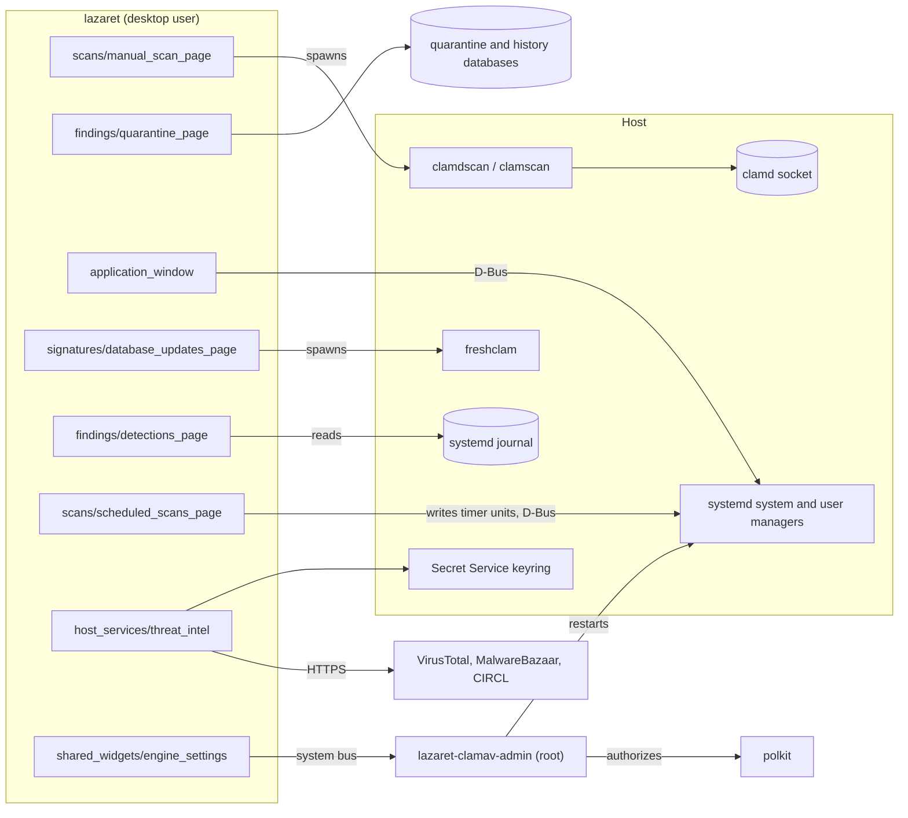
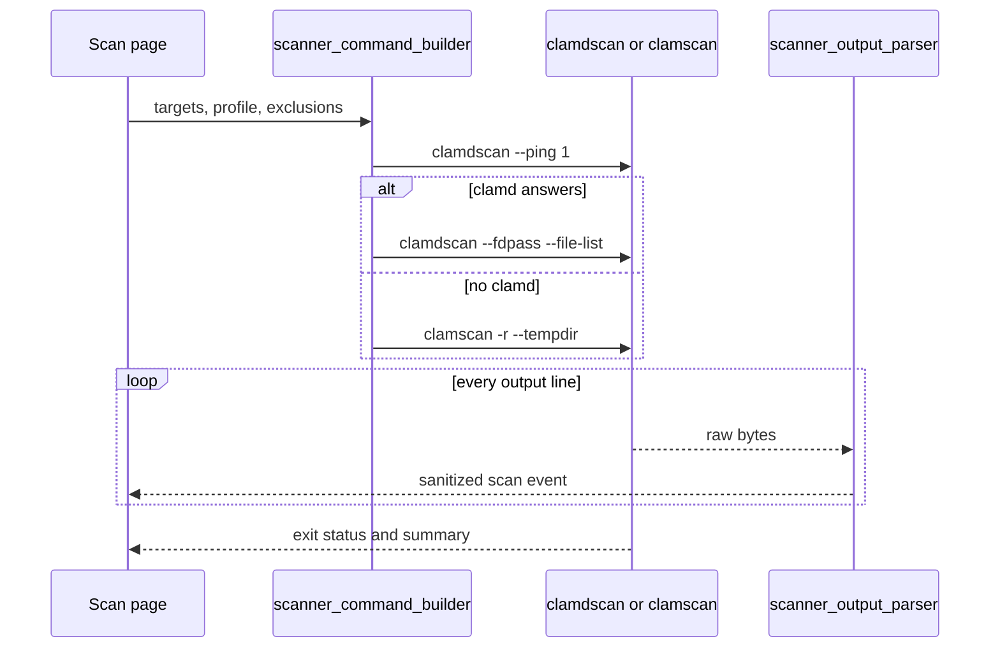
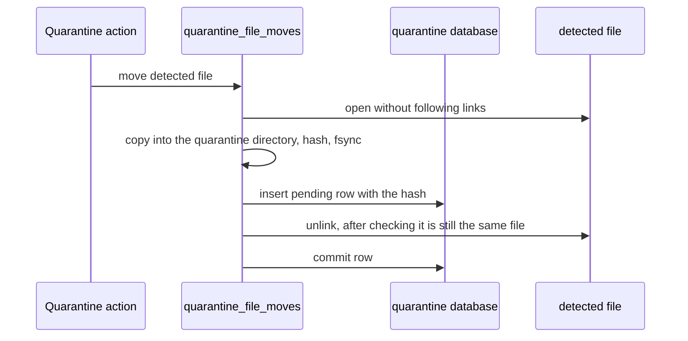
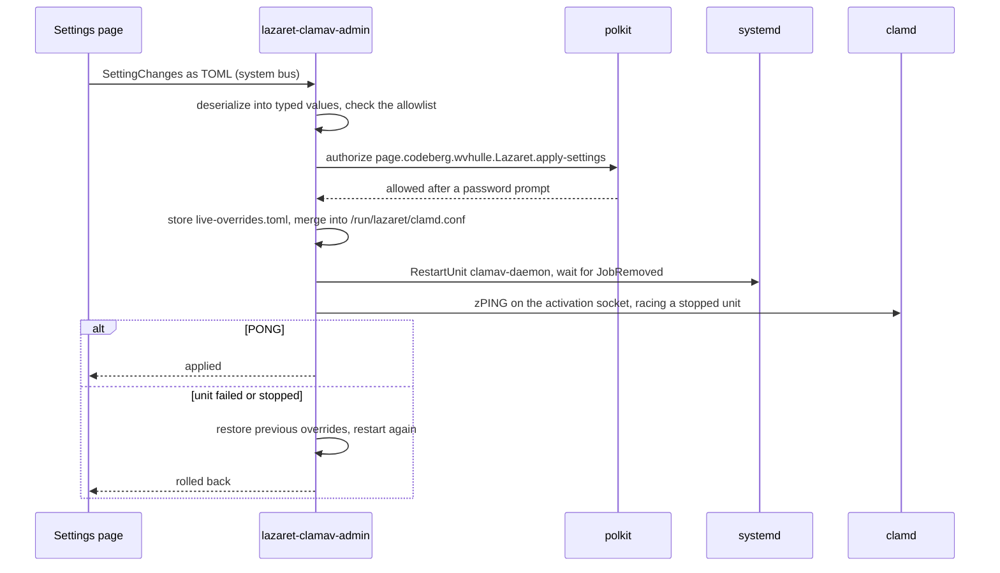
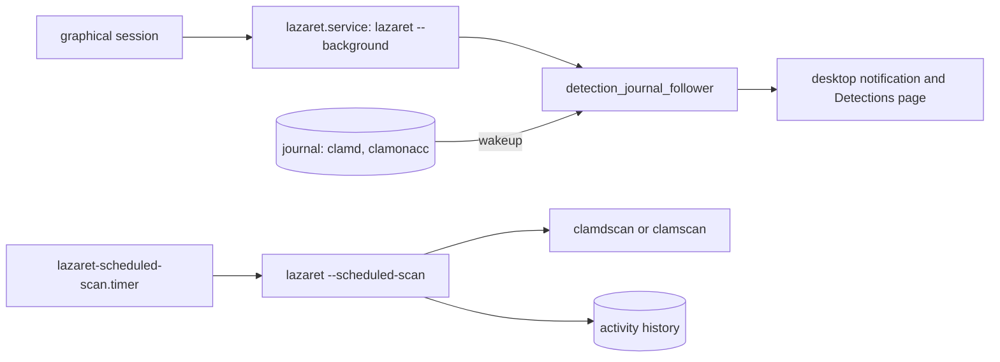
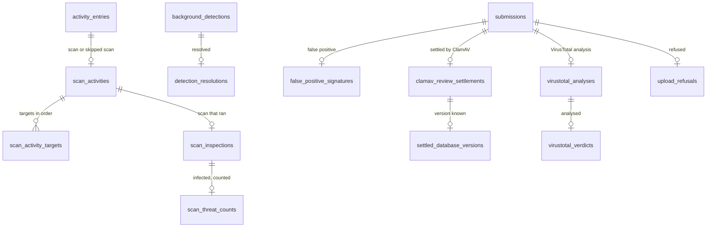
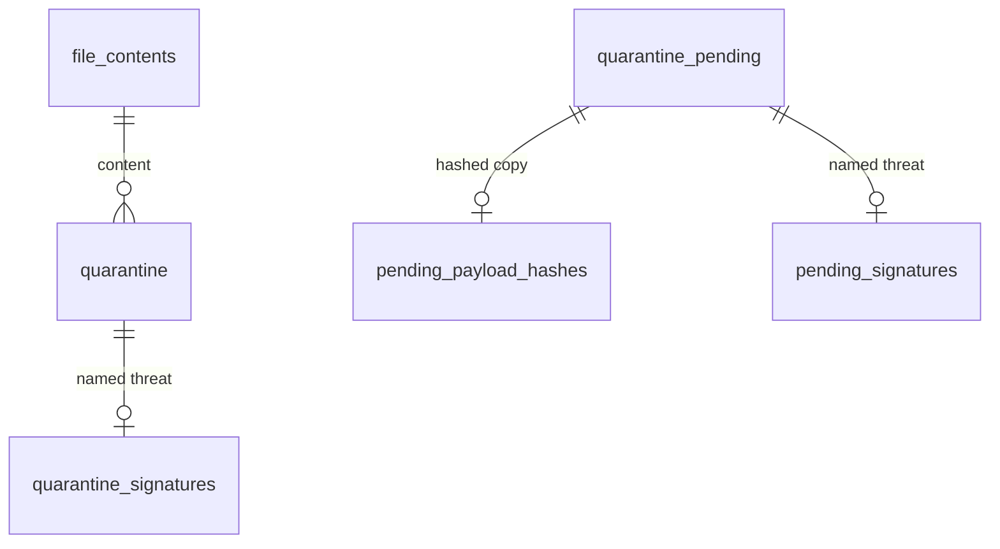
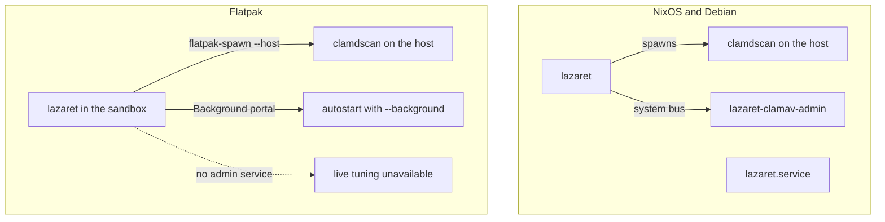

# Architecture

Lazaret is a desktop front-end for the ClamAV that is already installed on the host. It never bundles a scan engine and never runs as root. This page describes how the pieces fit together and which rules keep them safe. The rules for changing the code are in [development](development.md).

## Components

The source follows the window as you see it. Each sidebar group has a directory under `src/` with one directory per page: `signatures/` (`signature_sources_page/`, `database_updates_page/`), `scans/` (`scan_engine_page/`, `on_access_page/`, `scheduled_scans_page/`, `manual_scan_page/`, `removable_drives_page/`), `findings/` (`detections_page/`, `quarantine_page/`, `trusted_detections_page/`, `sent_samples_page/`). The subpages and dialogs you open from a page sit in directories inside it, for example `scans/manual_scan_page/exclusions_page/`. `application_window/` holds the window, the grouped sidebar, page routing, the tray, actions and startup arguments; it owns the protection evidence and passes each page the part it shows, and `preferences_dialog/` holds the Preferences dialog, including the Online Services page with the API keys. Widgets that several pages share live in `shared_widgets/`. Code you never see on screen lives in `host_services/`, grouped by what it talks to: the ClamAV programs, the quarantine vault, systemd, the journal, the ClamAV admin service and online lookups, with the protection evidence the sidebar and the pages read in `host_services/protection_evidence/`. `headless_modes/` holds the scheduled scan that runs without a window. `clamav_admin_service/` is the only code that runs with privileges, and `xtask/` holds the repository tasks: screenshots and recordings, packaging and releases.

The interface follows the Elm architecture through Relm4. The window shell owns startup, the tray and the close behaviour. A page navigation component owns the sidebar, the page stack and the settings subpages. Every page and dialog keeps its state in a plain model that only `update` changes, in answer to messages from widgets, child components, GTK actions and finished commands. Settings stored in GSettings are mirrored into the models that show them: a change sends a message, and `update` writes it back. Work that waits on the host runs as a command, and its outcome returns as a message, so no state is shared between widgets.

Lazaret talks to the host in three ways, and never through shell commands like `systemctl` or `journalctl`:

- It spawns the ClamAV programs found on `PATH`: `clamdscan --fdpass`, `clamscan` and `freshclam`. It only runs a copy that the desktop user can't replace: the file, every directory above it and every symbolic link on the way must be out of the user's control. Copies the user could replace, such as one in `~/.local/bin`, are skipped and reported on the Scan Engine and Database Updates pages. That way malware running as the user can't plant a fake `clamdscan` that reports every file as clean.
- It talks to systemd over D-Bus (`src/host_services/systemd_bus/`), for unit states, starting units and installing timers.
- It reads the journal through libsystemd (`src/host_services/systemd_journal/`).

Pages react to D-Bus signals and journal wakeups. They don't refresh on timers.

## Scanning

When clamd answers a ping, Lazaret scans through it and passes file descriptors with `--fdpass`, so clamd can read files the desktop user can read. Otherwise it falls back to `clamscan`. The scanner's output is a stream (`impl Stream`) of byte lines. File names can be arbitrary bytes, so lines are split as bytes and decoded lossily. Scanner text is sanitized before it is shown, and rows that show file names never interpret markup.

## Quarantine

A move always runs in this order: copy, pending row, remove source, commit. Every open is no-follow, and the payload is checked against the hash before the source is removed. A crash at any step leaves either the original file or a complete, recorded copy. A pending row tells the next start which step to finish. A move that has started is never aborted.

Payloads are stored neutralized: a header with a random per-file key, followed by the content XORed with that key. Other scanners, indexers and thumbnailers then see nothing they recognize, and a payload can't be run by accident. The recorded SHA-256 is always that of the original content, and every read decodes the payload first. A payload stored raw, such as one renamed into quarantine because on-access scanning blocked reading it, is neutralized afterwards by writing an encoded copy next to it, checking its hash and renaming it over the raw file. A crash leaves either the raw or the encoded payload, and both read back the same.

Quarantined content is checked again by piping the decoded payload into `clamdscan -` (or `clamscan -` without clamd), so it never has to be written back to disk to be scanned. This happens before every restore and after every successful signature update.

## Live tuning

All parsing, serializing and merging of clamd settings lives in the `clamd_configuration/` crate, which does no I/O. The settings Lazaret can change are fields of one typed record, `TunableRecord`. Each field has the value type clamd expects: switches, counts that fit the C `int` clamd parses them into, sizes as `ClamdSize` (binary `K`, `M` and `G` suffixes, `0` meaning no limit), contained absolute paths and single-line text. The same record is read from `clamd.conf` through a small serde format and from the stored state through TOML, so a value is checked once, when it is deserialized. Settings that run commands or change identity, listed in `clamd_configuration/setting_lists/protected-clamav-settings.txt`, have no field and can't be represented in a change at all. Rendered lines longer than ClamAV's `MAX_OPTION_LINE_LENGTH` are refused, because clamd would split them.

The admin service is started by D-Bus activation and authorizes each request with polkit, so the GUI is never trusted. It and the `merge` and `expire` runs of the same program are sandboxed by systemd: read-only system, no home directories, no network beyond local sockets (D-Bus, clamd and the journal), the `@system-service` system calls only, and no capabilities except reading files any user can't (`CAP_DAC_READ_SEARCH`) and, for the admin service, writing the allowlists in ClamAV's signature folder (`CAP_DAC_OVERRIDE`). The administrator-journey VM test checks that `systemd-analyze security` rates all three at 3.0 or lower. It only applies settings listed in `/etc/lazaret/tunable-settings`. Changes are stored in `/var/lib/lazaret/live-overrides.toml`, where each setting is either `permanent` or a `temporary-reduction` with `expires_at`. A change that reduces protection compared with the system configuration is stored as a temporary reduction and ends after `/etc/lazaret/reduction-lifetime` seconds; `lazaret-reduction-expiry.timer` removes it and restarts clamd. Setting a value equal to the system configuration, or going back to the system configuration, removes the entry. If the state file can't be read or holds anything that doesn't deserialize, the merge uses the system configuration unchanged.

`lazaret-settings-merge.service` writes `/run/lazaret/clamd.conf` from `/etc/clamav/clamd.conf` and the stored changes. It is `PartOf` clamav-daemon, so every restart of clamd, including the one `nixos-rebuild` or `apt` triggers after changing the system configuration, merges again first. clamd and clamonacc see the merged file at `/etc/clamav/clamd.conf` through `BindReadOnlyPaths`, so their start commands stay as the distribution wrote them.

The admin service waits for readiness without timeouts: the restart goes through systemd's `RestartUnit` and waits for the job's `JobRemoved` signal, then a `zPING` is sent to clamd's socket-activated socket, which blocks until the new clamd accepts it. If the unit fails or stops first, the change is rolled back.

The Detection settings page maps to `DetectPUA`, `HeuristicAlerts`, `AlertOLE2Macros`, `AlertEncrypted`, `ScanArchive` and `AlertExceedsMax`, which the NixOS module allows by default. `clamscan` doesn't read `clamd.conf`, so every `clamscan` run gets the same values as `--detect-pua=…` and similar flags, read from the configuration clamd uses.

## Trusted detections

Trust is per user by default. The `trusted_contents` and `ignored_signatures` tables in the user's `lazaret.db` hold the SHA-256 hashes and detection names that user trusted, without any privilege. Lazaret applies them to its own scans (manual, removable drive and scheduled): a detection whose name is ignored, or whose file is a regular file (never a symbolic link) with a trusted size and hash, is reported as skipped instead of as a threat and is not quarantined automatically. Background alerts only apply ignored names and never open the detected file, because with on-access blocking that open would be scanned and reported again, feeding back into the journal. If the user's trust can't be read, every detection is shown and the scan reports the problem. ClamAV itself, clamonacc blocking and other users are unaffected.

Trusting a file for all users goes through the admin service, which maintains `lazaret-local.sfp` (SHA-256 and size of trusted files) in the signature directory. It can also remove entries from `lazaret-local.ign2` (ignored detection names), but no longer adds any: an ignored name hides every file with that detection for every user, which is too broad to grant system-wide. Each change has its own polkit action, `page.codeberg.wvhulle.Lazaret.trust-detection`, and the prompt names the exact hash or detection name. Heuristic detections can only be trusted by hash, per user as well as system-wide. Stop ignoring removes a name whether or not its line is pinned with the `:md5` of the database entry. The lists are never read or written through a symbolic link, and lines that don't fit their format are dropped. After a change the admin service asks clamd to reload its signatures.

Every settings change, expiry and trust request, also refused ones, is written by the admin service to the system journal with `LAZARET_ACTION`, `LAZARET_SUBJECT`, `LAZARET_OUTCOME`, `LAZARET_REQUESTER_UID`, `LAZARET_WEAKENS_PROTECTION` and `LAZARET_PROTECTION_REDUCTION`, the kind of reduction. Temporary reductions record `LAZARET_EXPIRES_AT`. Trust requests also record the exact `LAZARET_SHA256` or `LAZARET_SIGNATURE_NAME`, so Lazaret attributes each trust entry by exact match. When the admin service can't read the clamd configuration, it records a change as `current-values-unknown` rather than as harmless. Lazaret reads these records back only from `_SYSTEMD_UNIT=lazaret-clamav-admin.service` with `_UID=0`, so software running as the desktop user can neither forge nor erase them. The Trusted Detections page warns about allowlists in the signature directory that Lazaret didn't write.

## Background alerts and scheduled scans

`lazaret --background` runs without a window and follows the journal of the ClamAV services. A detection by clamd or clamonacc raises an alert, and the Detections page shows its timeline. Scheduled scans are a systemd user timer and service that Lazaret writes to `~/.config/systemd/user`. The service runs a headless scan with the same scanner code as the Scan page.

## Stored data

Lazaret keeps one SQLite database, `lazaret.db`, in its data directory: `$XDG_DATA_HOME/lazaret`, or `~/.local/share/lazaret` when that variable is unset, found with the `xdg` crate. Debug and release builds share it. Inside the Flatpak, `XDG_DATA_HOME` points into the sandbox. Quarantined payloads sit in the `quarantine` directory next to the database. The tables are created by the numbered SQL files in `migrations/`, which are compiled into the binary. Each open reads `PRAGMA user_version` and applies the files it hasn't applied yet in order, each in its own transaction that also raises the version. A database with a higher version comes from a newer release and is refused without being changed. The screenshot fixtures and the tests create their databases through the same migrations.

Every store opens the file through `host_services::lazaret_database::locked_database_connection`, which holds `lazaret.lock` for as long as the connection lives, so only one connection in one process uses the file at a time; turso doesn't allow two processes to have it open together. Connections are short and a store never opens a second one while it holds the first. The window also holds `quarantine.lock` for as long as it runs, so only one process moves files into or out of quarantine; a scheduled scan that finds it taken leaves its detections in place. The quarantine lock is taken first and only ever around the database lock, so the two can't wait on each other.

The tables follow the shape of the Rust types: each state that carries its own data has its own detail table, keyed like its parent and deleted with it, so a column never holds a placeholder such as `0` or `''`. `CHECK` constraints list the valid values and combinations, and every connection turns on `PRAGMA foreign_keys`. Detail tables repeat the parent's status in their key, so a foreign key ties each detail row to the one status it belongs to.

### History tables

| Table | Key | References | Stores |
|---|---|---|---|
| `activity_entries` | `entry_id` | | One scan or signature update: start, status, duration and output. |
| `scan_activities` | `entry_id` | `activity_entries (entry_id, activity_status)` | The origin of a scan. A skipped scan is always scheduled. |
| `scan_activity_targets` | `entry_id, target_position` | `scan_activities` | One scanned path per row, in the order given. |
| `scan_inspections` | `entry_id` | `scan_activities (entry_id, activity_status)` | How many files a scan that ran inspected. Skipped scans have none. |
| `scan_threat_counts` | `entry_id` | `scan_inspections (entry_id, activity_status)` | The threat count of an infected scan. An infected scan without this row found threats it couldn't count. |
| `background_detections` | `file_path, signature_name`; `detection_id` is unique too | | One file that clamd or clamonacc reported for one signature: which scanners saw it, when, and how often. The journal follower matches new lines on the key. The pages and the incident view refer to a detection by `detection_id`. |
| `detection_resolutions` | `file_path, signature_name` | `background_detections` | How and when you resolved a detection. An open detection has no row, and a later sighting deletes it. |
| `detection_journal_position` | `position_row`, always 1 | | The journal cursor the follower continues from. |
| `submissions` | `content_sha256, submission_service, submission_kind` | | One file sent to ClamAV, MalwareBazaar or VirusTotal: its name, when, and its status. A `CHECK` lists the statuses each service and kind can have. |
| `false_positive_signatures` | as `submissions` | `submissions`, with its status | The signature reported as a false positive. |
| `clamav_review_settlements` | as `submissions` | `submissions`, with its status | A ClamAV report that a signature update settled. |
| `settled_database_versions` | as `submissions` | `clamav_review_settlements` | The daily database version that settled it. Without this row Lazaret couldn't read the version. |
| `virustotal_analyses` | as `submissions` | `submissions`, with its status | The VirusTotal analysis ID of an upload. |
| `virustotal_verdicts` | as `submissions` | `virustotal_analyses`, with its status | How many engines flagged the file, out of how many. |
| `upload_refusals` | as `submissions` | `submissions`, with its status | Why MalwareBazaar or VirusTotal refused an upload. |

### Quarantine tables

| Table | Key | References | Stores |
|---|---|---|---|
| `file_contents` | `content_sha256` | | The size of each quarantined content, by its lowercase SHA-256. Removed with the last entry that holds it. |
| `quarantine` | `entry_id`; `quarantine_path` is unique too | `file_contents` | One quarantined file: where it came from, where its payload is, when it was detected and its permission bits. |
| `quarantine_signatures` | `entry_id` | `quarantine` | The signature that detected the file. An entry without this row was blocked by on-access scanning before a signature was known. |
| `quarantine_pending` | `quarantine_path` | | A move that has started but not committed: source, planned size and permission bits. |
| `pending_payload_hashes` | `quarantine_path` | `quarantine_pending` | The hash of a copied payload. A blocked file renamed into quarantine has no hash until the next start computes it. |
| `pending_signatures` | `quarantine_path` | `quarantine_pending` | The signature of a pending move, with the same meaning as `quarantine_signatures`. |

A submission names its content by the same SHA-256 as `file_contents`, but has no foreign key to it: a submitted file may never have been quarantined, and `file_contents` loses its row when the last quarantined copy is restored or deleted, while the submission stays. A detection has no key to a quarantine entry for the same reason. Lazaret still treats an entry whose stored hash or detection date doesn't parse as unverified, so a database edited by hand can't make it restore unchecked content.

## Deployments

The NixOS module and the Debian package install the admin service, its polkit action, its D-Bus configuration and the user service. The Flatpak can't ship a privileged admin service, so live tuning is not available there. Inside the sandbox, Lazaret runs the ClamAV programs on the host with `flatpak-spawn --host`. Paths under `/run/host` are translated back to host paths before they reach the scanner. The sandbox starts in the background through the Background portal instead of a systemd user service.
